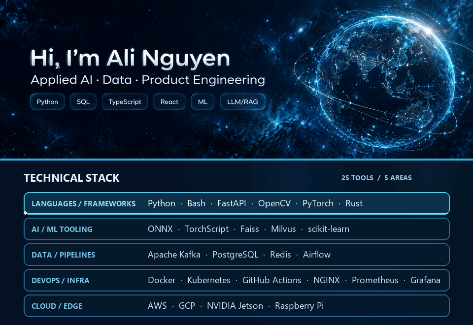
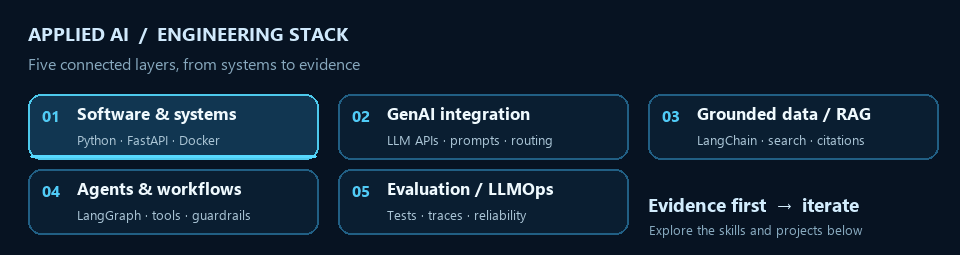
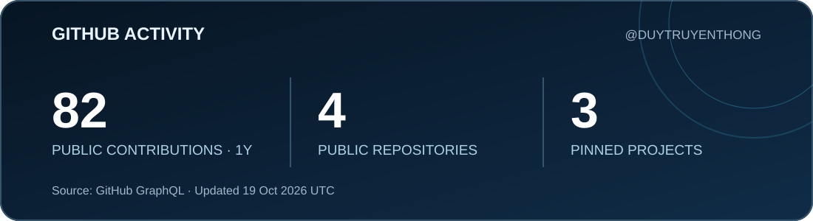

# Ali Nguyen · Applied AI engineer 👋

I am **Nguyen Quang Duy (Ali Nguyen)**, a Computer Science graduate of Vietnamese-German University and founder of **DUYTRUYENTHONG**. I build testable Python ML baselines, developer tools for AI-assisted delivery, and data-informed commerce products. My work connects data boundaries and tests with software that people can use.

[Applied AI CV](https://duytruyenthong.github.io/Alinguyen-portfolio/cv-applied-ai-engineer.pdf) · [Portfolio and case studies](https://duytruyenthong.github.io/Alinguyen-portfolio/) · [Recruiter evidence map](https://github.com/DUYTRUYENTHONG/Alinguyen-portfolio/blob/main/docs/RECRUITER_BRIEF.md) · [Email me](mailto:nquangd1510@gmail.com)

## Work you can inspect

| Project | Engineering evidence | Status |
| --- | --- | --- |
| [KKBox churn baseline](https://github.com/DUYTRUYENTHONG/kkbox-customer-churn-prediction) | Python, Pandas, scikit-learn; snapshot-cutoff feature construction, a synthetic future-data leakage test, and a reproducible holdout evaluation protocol | Public source and tests; [official-data results pending](https://github.com/DUYTRUYENTHONG/kkbox-customer-churn-prediction/blob/main/docs/RESULTS.md) |
| [Vibecode Product Kit](https://github.com/DUYTRUYENTHONG/vibecode-product-kit) | Offline Node.js CLI, validation, tests, and GitHub Actions for traceable AI-assisted product delivery | Public developer tool; no measured adoption claim |
| [Ali Nguyen portfolio](https://github.com/DUYTRUYENTHONG/Alinguyen-portfolio) | Next.js/TypeScript source, project records, CVs, and GitHub Pages workflow | Public source and [live site](https://duytruyenthong.github.io/Alinguyen-portfolio/) |
| [Growth Commerce OS](https://growth-commerce-os.vercel.app/en), [STOS](https://stosvn.vercel.app/stos), and [Chợ Kênh](https://growth-commerce-os.vercel.app/cho-kenh) | Customer-facing service, sales-page, and marketplace workflows | Live websites; implementation is private and business impact is unmeasured |

## Technical skills

**Core stack and current focus:** Python · FastAPI · SQL · TypeScript · Docker · Google Analytics 4 · LangChain/LangGraph · scikit-learn · CI/CD

### Technical stack

| Area | Tools and technologies |
| --- | --- |
| Languages & frameworks | Python, Bash, FastAPI, OpenCV, PyTorch, Rust |
| AI/ML tools | ONNX, TorchScript, Faiss, Milvus, scikit-learn |
| Data & pipelines | Apache Kafka, PostgreSQL, Redis, Airflow |
| DevOps & infrastructure | Docker, Kubernetes, GitHub Actions, NGINX, Prometheus, Grafana |
| Cloud & edge | AWS, GCP, NVIDIA Jetson, Raspberry Pi |

This owner-supplied stack includes hands-on tools and areas of active study. The linked source and writing below distinguish implemented work from design studies; listing a technology does not imply that every named service is deployed in production.

### 01 · Software and systems

- **Public code:** Python, Pandas, JavaScript/TypeScript, React, Next.js, Node.js, Git, GitHub Actions, and automated tests.
- **Backend and operations toolkit:** SQL/PostgreSQL, FastAPI, Flask, REST/GraphQL API design, async programming, JSON, Linux CLI, Docker, and CI/CD pipelines. I am developing depth in Java/C++, Kubernetes, AWS, GCP, and Azure.

### 02 · GenAI integration

- **Public design study:** Prompt and retrieval design documented in my [grounded assistant note](writing/grounded-marketing-assistant.md); it is not a deployed LLM service.
- **Current focus:** OpenAI, Anthropic, and Gemini APIs; Hugging Face, Together AI, Baseten, and Ollama for open or hosted models; system prompts, JSON-schema structured outputs, context-window management, token optimization, and cost-aware model routing.

### 03 · Data grounding and RAG

- **Public evidence:** Pandas feature construction in the [KKBox baseline](https://github.com/DUYTRUYENTHONG/kkbox-customer-churn-prediction) and a [retrieval design note](writing/grounded-marketing-assistant.md) covering citations and permission boundaries.
- **Current focus:** Document parsing, semantic chunking, hybrid dense/sparse search, reranking, LangChain, LlamaIndex, and Haystack. I compare pgvector, Qdrant, Pinecone, Milvus, and Weaviate as vector-store options rather than claiming production use of each.

### 04 · Agents and workflows

- **Public evidence:** Reproducible AI-assisted delivery and CI checks in public repositories; no deployed autonomous agent is claimed.
- **Current focus:** LangGraph orchestration, tool/function calling, bounded planning, short- and long-term memory, approval gates, and guardrails. I evaluate CrewAI, AutoGen, and custom execution loops against task requirements.

### 05 · Evaluation and LLMOps

- **Project-backed:** scikit-learn holdout protocol, snapshot-date leakage tests, and explicit [KKBox results status](https://github.com/DUYTRUYENTHONG/kkbox-customer-churn-prediction/blob/main/docs/RESULTS.md).
- **Current focus:** Deterministic assertions, LLM-as-a-judge, Ragas, DeepEval, and regression sets; LangSmith, Arize Phoenix, OpenTelemetry, and custom latency, token, and error tracing.

**Marketing technology:** Google Analytics 4 attribution and event-scope analysis, Power BI/DAX reporting, Google Business Profile, TikTok Shop operations, customer discovery, and commerce funnel design. My [funnel measurement note](writing/commerce-funnel-measurement.md) distinguishes first-user, session, and event attribution scopes.

The [recruiter brief](https://github.com/DUYTRUYENTHONG/Alinguyen-portfolio/blob/main/docs/RECRUITER_BRIEF.md) maps capabilities to source, live pages, and evidence limits.

## Engineering and research interests

- Reliable AI answers grounded in retrievable sources
- Time-aware evaluation of customer models without future-data leakage
- Interfaces that help people interpret uncertain AI outputs
- Reproducible, reviewable AI-assisted software delivery

## Technical writing: AI and data in marketing technology

I write about the decisions behind customer-facing AI and measurement systems. These notes show how I frame data boundaries, evaluation, and product tradeoffs; they do not claim production deployments or measured business gains.

| Note | Engineering question | Related work |
| --- | --- | --- |
| [Predict churn from what was known then](writing/snapshot-safe-churn.md) | How do we define a customer snapshot and test for future-data leakage? | [KKBox baseline](https://duytruyenthong.github.io/Alinguyen-portfolio/#project-kkbox-baseline) |
| [A source-grounded marketing knowledge assistant](writing/grounded-marketing-assistant.md) | How do retrieval, permissions, citations, and evaluation fit together? | [Applied AI expertise](https://duytruyenthong.github.io/Alinguyen-portfolio/#ai-expertise) |
| [Measure a commerce funnel without mixing attribution scopes](writing/commerce-funnel-measurement.md) | What can event data tell us about a funnel, and what can it not prove? | [Growth Commerce OS](https://growth-commerce-os.vercel.app/en) |

## GitHub stats

The card uses GitHub's contribution calendar and repository data. It counts public contributions; the owner's signed-in graph may also include private activity. It shows its last refresh date and is not a code-quality or impact score. [View the contribution activity on GitHub](https://github.com/DUYTRUYENTHONG?tab=overview).

## For recruiters and graduate admissions

- **Recruiters:** The [recruiter brief](https://github.com/DUYTRUYENTHONG/Alinguyen-portfolio/blob/main/docs/RECRUITER_BRIEF.md) maps capabilities to source, live pages, and evidence limits. [Download the Applied AI CV](https://duytruyenthong.github.io/Alinguyen-portfolio/cv-applied-ai-engineer.pdf).
- **Master's admissions:** I hold a **Bachelor of Computer Science from Vietnamese-German University** (2021–2026). I am interested in reliable applied AI, retrieval-grounded answers, temporal evaluation of customer models, and human-facing systems. The [admissions brief](https://github.com/DUYTRUYENTHONG/Alinguyen-portfolio/blob/main/docs/ACADEMIC_BRIEF.md) outlines research questions and preparation. Admissions reviewers can request official degree documents and transcripts directly from me.

I do not present local prototypes as deployed AI services or claim unverified model scores, research publications, adoption, or revenue outcomes.

## Connect

[Website](https://duytruyenthong.github.io/Alinguyen-portfolio/) · [Email](mailto:nquangd1510@gmail.com) · [DUYTRUYENTHONG](https://growth-commerce-os.vercel.app/en)
